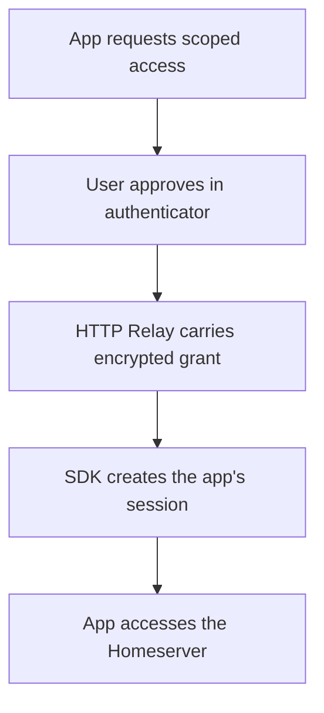
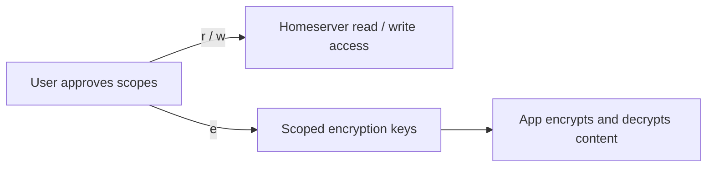

Pubky apps request scoped access to a user's Homeserver through grant authentication. A key manager such as [Pubky Ring](/pubky-ring/) lets the user approve the request without giving the app their identity key.

## From approval to a session

An application asks for the permissions its features need, such as reading and writing files in its own storage path. It presents an authorization link or QR code. The user reviews the request in their authenticator, which approves access and delivers an encrypted grant through an [HTTP Relay](/http-relay/). The SDK turns that approval into a session the app can use for authenticated requests.

The app's session is distinct from the identity key. Its permissions limit what it can access on the Homeserver, and grants can be revoked. Reading someone else's public data does not require their approval; writing data or accessing authenticated storage does. The [Security Model](/security-model/) explains these boundaries.

Review requested scopes before approving an app. Root grants carry account-level privileges and should be reserved for trusted account-management tools.

Authenticators can approve fewer scopes or actions than an app requests, so apps should inspect the granted capabilities before enabling features. Signer developers use the [selective approval APIs](https://github.com/pubky/pubky-homeserver/blob/{{pinned_homeserver_release}}/docs/scoped-encryption-keys.md#select-capabilities-on-the-signing-device) to apply the user's selection; `approveAuthRequest()` (JavaScript) and `approve_auth()` (Rust) approve the full request.

When asking a signed-in user for additional permissions, [include their public key in the authorization request](https://github.com/pubky/pubky-homeserver/blob/{{pinned_homeserver_release}}/pubky-sdk/bindings/js/pkg/README.md#require-the-signed-in-identity). This ensures the approval comes from the same account. Leave this constraint out for first sign-in or account switching.

## Scoped encryption keys

Apps can request symmetric encryption keys for specific storage paths alongside a grant. The `e` action requests keys; `r` and `w` control storage access independently. Key requests use signed approvals (`approvalFormat: "signedApprovalV1"` in JavaScript) and require a signer and Homeserver that support encryption scopes. Check the approved scopes: the signer can narrow or decline the request.

Signed approvals use Hybrid Public Key Encryption (HPKE) to deliver the grant and any approved keys to the requesting app. The SDK supplies keys; the app encrypts its content. Delivered keys remain usable after grant expiry or revocation. See the [scoped encryption keys guide](https://github.com/pubky/pubky-homeserver/blob/{{pinned_homeserver_release}}/docs/scoped-encryption-keys.md) for examples and compatibility, and the [Security Model](/security-model/#scoped-encryption-keys) for key handling and trust boundaries.

## Browser sessions

A grant has one current bearer token. Tabs on the same origin and browser profile coordinate its use through the SDK.

Use the SDK's `browserSessionStore` to keep your app signed in across page reloads and tabs on the same origin. Save the session before making requests so the SDK can share it across tabs. Treat saved session data as credentials.

Each app should request its own grant. Apps that share a grant across separate origins can invalidate each other's bearer tokens and interrupt sessions. See the [grant session lifecycle guide](https://github.com/pubky/pubky-homeserver/blob/{{pinned_homeserver_release}}/docs/grant-session-lifecycle.md) for browser requirements, session persistence, and compatibility with older Homeservers.

## Signing out

Signing out an active grant-backed session through the SDK revokes its grant. Revocation invalidates every session issued from that grant and prevents saved credentials for it from restoring access. Separate grants, including those issued to the same app, are unaffected.

Removing saved browser session data does not revoke the grant on the Homeserver. See the [grant session lifecycle guide](https://github.com/pubky/pubky-homeserver/blob/{{pinned_homeserver_release}}/docs/grant-session-lifecycle.md) for browser sign-out behavior, failure recovery, and Homeserver compatibility.

## Custom proofs

Grant sessions can sign custom JSON with the app's proof-of-possession key. A receiving service can verify the user's signature on the grant and the app's signature on the data offline, without contacting the Homeserver.

The SDK verifier checks signatures and grant validity, but does not check revocation or prevent replay. The receiving service must enforce its own authorization and replay policies, including any audience, challenge, and freshness checks. See [Sign and verify custom data](https://github.com/pubky/pubky-homeserver/blob/{{pinned_homeserver_release}}/docs/CUSTOM_POP.md) for examples and the verification contract.

## Implement the flow

Use the SDK guides to implement this flow:

- [JavaScript grant authentication example](https://github.com/pubky/pubky-homeserver/blob/{{pinned_homeserver_release}}/examples/javascript/2-auth-flow/README.md).
- [Rust grant authentication example](https://github.com/pubky/pubky-homeserver/blob/{{pinned_homeserver_release}}/examples/rust/2-auth_flow/README.md).
- [Browser session persistence example](https://github.com/pubky/pubky-homeserver/blob/{{pinned_homeserver_release}}/examples/javascript/5-browser-session-persistence/README.md).

For raw endpoints, see the [Homeserver API references](/homeserver/#http-api). For key custody and Homeserver trust, read the [Security Model](/security-model/).
